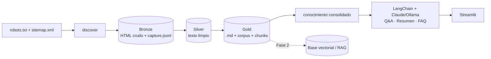

# 🛡️ Asistente de conocimiento · Seguros Bolívar

 
 

Proyecto integrador de **Técnicas Avanzadas de IA en Modelos de Lenguaje** (UAO · Grupo 10 ·
Daniel Silva y Katherine Medina). **Fase 1:** base de conocimiento semántico y sistema Q&A sobre la
información **pública** de Seguros Bolívar, alcance **personas + canales de atención**.

## Arquitectura



| Capa | Dónde | Qué hace |
|---|---|---|
| Scraping | `src/sb_asistente/scraping/` | robots + sitemap, filtro de alcance, descarga con cortesía (1,5 s) |
| Procesamiento | `src/sb_asistente/processing/` | `<main>` → Markdown (trafilatura), quita boilerplate, pie de canales una vez |
| LLM | `src/sb_asistente/llm/` | prompts versionados (v1–v4: zero-shot a few-shot), servicio LangChain |
| Vista | `src/sb_asistente/view/` | Streamlit con 3 pestañas |
| Orquestación | `pipeline.py`, `cli.py` | comando `sb` |

## Instalación

```bash
uv sync
cp .env.example .env          # y escriba su ANTHROPIC_API_KEY
uv run pre-commit install     # ruff + bloqueo de datos/secretos + GGA + mensaje semántico (commit-msg)
```

## Uso

```bash
# 1. Datos (Bronze → Silver → Gold). ~4 minutos por la pausa de cortesía.
uv run sb discover
uv run sb scrape
uv run sb process
uv run sb stats

# 2. Tareas
uv run sb ask "¿Cuál es el WhatsApp de atención?"
uv run sb summary --topic "Seguros de hogar, arrendamiento y mascotas"
uv run sb faq --topic "Canales de atención y servicio al cliente" -n 5

# 3. Evaluación (24 preguntas) y experimentación de prompts
uv run sb eval --version v3
uv run sb eval --version v1          # línea base para comparar
uv run sb eval --provider ollama     # gratis, local

# 4. Interfaz
uv run streamlit run src/sb_asistente/view/streamlit_app.py
```

## Pruebas

```bash
uv run pytest -v --cov     # sin red ni API: fixtures HTML y LLM falso
uv run ruff check . && uv run ruff format --check .
```

## Ética y datos
Solo información pública; se respeta `robots.txt`; sin login, sin datos personales (Ley 1581 de 2012).
`data/` y `.env` no se versionan. Ver `docs/alcance.md` y `docs/decisiones/`.

## Documentación
- `docs/alcance.md` · investigación de fuentes y alcance del Q&A
- `docs/decisiones/` · decisiones técnicas (espejo de Engram)
- `openspec/` · especificación de la Fase 1
- `informe/` · artículo IEEE
