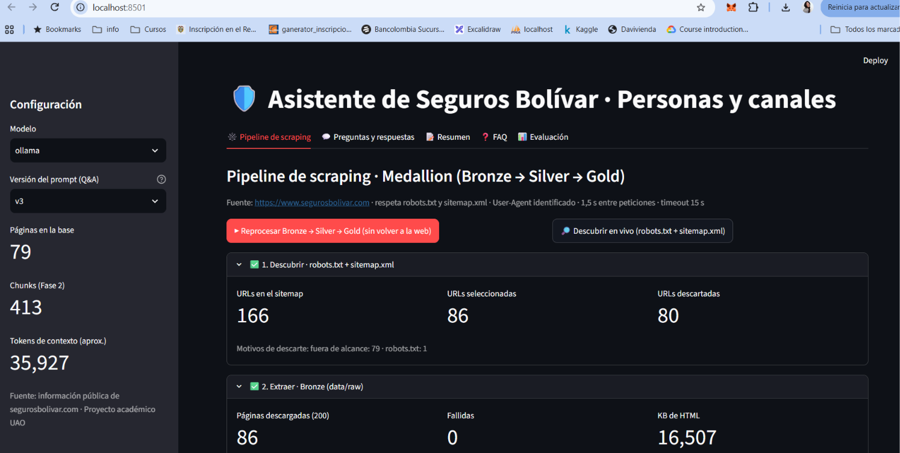
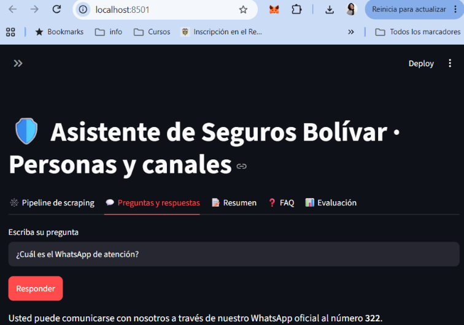
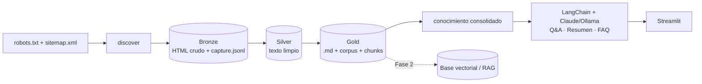

# 🛡️ Asistente de conocimiento · Seguros Bolívar

 
 
 

Proyecto integrador de **Técnicas Avanzadas de IA en Modelos de Lenguaje** (UAO · Grupo 10 ·
Daniel Silva y Katherine Medina). **Fase 1:** base de conocimiento semántico y sistema Q&A sobre la
información **pública** de Seguros Bolívar, alcance **personas + canales de atención**.

## Problema y solución

**Problema.** La información de Seguros Bolívar para personas (coberturas, requisitos, canales de
atención) está repartida en decenas de páginas con menús, banners y textos repetidos; responder una
duda concreta obliga a navegar mucho y no siempre se sabe de qué página salió el dato.

**Solución.** Un pipeline de scraping ético convierte el sitio público en un corpus limpio con
metadatos (URL, título, sección, fecha de captura y hash), y un asistente con LangChain responde
preguntas, resume y genera FAQ **citando la URL de origen**.

## Inicio rápido

```bash
uv sync
uv run python scripts/scrape_empresa.py     # descubrir → extraer → limpiar → deduplicar → enriquecer
uv run streamlit run app.py                 # interfaz: pipeline por etapas + Q&A con fuente
```

## Capturas

| Pipeline de scraping por etapas | Q&A con cita de la fuente |
|---|---|
|  |  |

## Arquitectura



| Capa | Dónde | Qué hace |
|---|---|---|
| Scraping | `src/sb_asistente/scraping/` | robots + sitemap, filtro de alcance, descarga con cortesía (1,5 s) |
| Procesamiento | `src/sb_asistente/processing/` | `<main>` → Markdown (trafilatura), quita boilerplate, pie de canales una vez |
| LLM | `src/sb_asistente/llm/` | prompts versionados (v1–v4: zero-shot a few-shot), servicio LangChain |
| Vista | `src/sb_asistente/view/`, `app.py` | Streamlit: pipeline por etapas, Q&A con fuentes, Resumen, FAQ, Evaluación |
| Orquestación | `pipeline.py`, `cli.py` | comando `sb` |

## Instalación

```bash
uv sync
cp .env.example .env          # y escriba su ANTHROPIC_API_KEY
uv run pre-commit install     # ruff + bloqueo de datos/secretos + GGA + mensaje semántico (commit-msg)
```

## Uso

```bash
# 1. Datos (Bronze → Silver → Gold). ~4 minutos por la pausa de cortesía.
uv run sb discover
uv run sb scrape
uv run sb process
uv run sb stats

# 2. Tareas
uv run sb ask "¿Cuál es el WhatsApp de atención?"
uv run sb summary --topic "Seguros de hogar, arrendamiento y mascotas"
uv run sb faq --topic "Canales de atención y servicio al cliente" -n 5

# 3. Evaluación (24 preguntas) y experimentación de prompts
uv run sb eval --version v3
uv run sb eval --version v1          # línea base para comparar
uv run sb eval --provider ollama     # gratis, local

# 4. Interfaz
uv run streamlit run app.py
```

## Pruebas

```bash
uv run pytest -v --cov     # sin red ni API: fixtures HTML y LLM falso
uv run ruff check . && uv run ruff format --check .
```

## Ética y datos
Solo información pública; se respeta `robots.txt`; sin login, sin datos personales (Ley 1581 de 2012).
`data/` y `.env` no se versionan. Ver `docs/alcance.md` y `docs/decisiones/`.

## Documentación
- `docs/alcance.md` · investigación de fuentes y alcance del Q&A
- `docs/decisiones/` · decisiones técnicas (espejo de Engram)
- `openspec/` · especificación de la Fase 1
- `informe/` · artículo IEEE

## Estructura

```
app.py                     # entrada de Streamlit
scripts/scrape_empresa.py  # pipeline completo (o --solo-proceso, sin red)
src/sb_asistente/
├── scraping/              # discover (robots + sitemap) y fetch (Bronze, cortesía 1,5 s)
├── processing/            # clean (Silver) y gold (Markdown con front-matter, corpus.jsonl, chunks)
├── llm/                   # prompts versionados y servicio LangChain (Claude u Ollama)
├── view/streamlit_app.py  # interfaz
├── pipeline.py            # orquesta las etapas y reporta sus métricas
└── cli.py                 # comando `sb`
data/raw · data/silver · data/gold   # Medallion (no versionado)
tests/                     # pytest con fixtures HTML y LLM falso, sin red
```

## Licencia

[MIT](LICENSE) © 2026 Daniel Silva y Katherine Medina. El contenido extraído pertenece a Seguros
Bolívar S.A. y se usa solo con fines académicos; no se redistribuye (`data/` no se versiona).

## Créditos

- **Equipo:** Daniel Silva y Katherine Medina (Code Reviewer: Daniel Silva).
- **Curso:** Técnicas Avanzadas de IA en Modelos de Lenguaje · Maestría en IA y Ciencia de Datos · UAO.
- **Librerías:** LangChain, trafilatura, BeautifulSoup, Streamlit, requests, uv, pytest y ruff.
- **Fuente de datos:** sitio público www.segurosbolivar.com.
