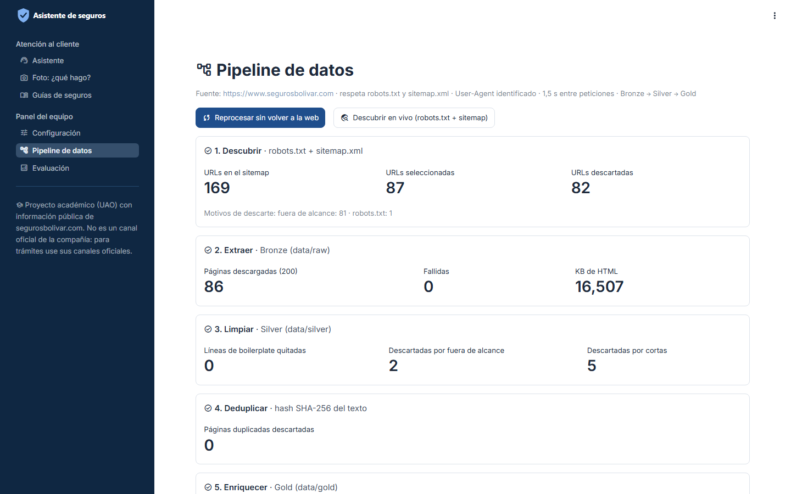
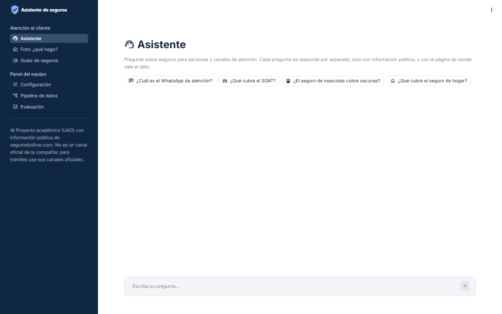
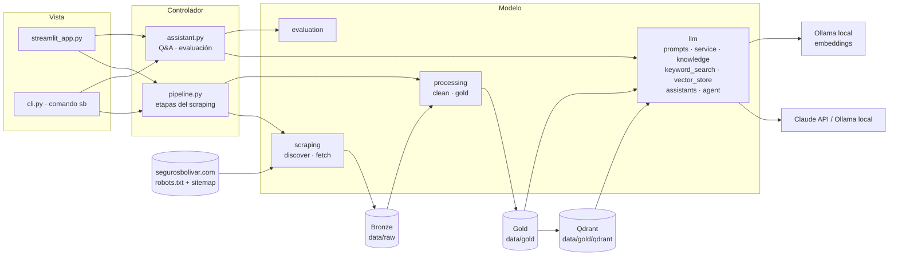
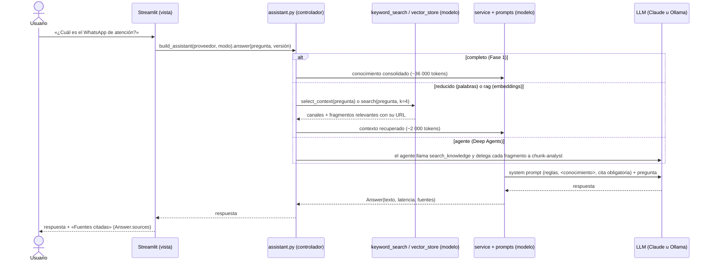

# 🛡️ Asistente de conocimiento · Seguros Bolívar

[](https://github.com/anakmedina08/advanced-ai-lab/actions/workflows/ci.yml)
 
 
 


Producto único de dos cursos de la Maestría en IA de la UAO (Daniel Silva y Katherine Medina):
**Técnicas Avanzadas de IA en Modelos de Lenguaje** aporta el módulo de conocimiento (scraping
Medallion + Q&A con fuentes sobre la información **pública** de Seguros Bolívar) y **Gestión de
Proyectos en IA y CD** el módulo de recomendación de seguros. Ambos se exponen con una API FastAPI.

> ✅ Qué pide cada curso y dónde está la evidencia: [`docs/requisitos.md`](docs/requisitos.md).

> 📘 La fuente única de verdad del proyecto es [`CONSTITUTION.md`](CONSTITUTION.md).

## Tabla de contenidos

- [Problema y solución](#problema-y-solución)
- [Inicio rápido](#inicio-rápido)
- [Capturas](#capturas)
- [Arquitectura MVC](#arquitectura-mvc)
- [Flujo de inferencia](#flujo-de-inferencia)
- [Uso](#uso)
- [API (FastAPI + Pydantic)](#api-fastapi--pydantic)
- [JSON-RPC 2.0](#json-rpc-20)
- [RAG y agente](#rag-y-agente)
- [Chat orquestado](#chat-orquestado)
- [Skills](#skills)
- [Recomendador (curso de Gestión)](#recomendador-curso-de-gestión)
- [Docker](#docker)
- [Pruebas y calidad](#pruebas-y-calidad)
- [Spec-Driven Development y tablero](#spec-driven-development-y-tablero)
- [Agentes de IA](#agentes-de-ia)
- [Estructura](#estructura)
- [Ética y datos](#ética-y-datos)
- [Contribución](#contribución)
- [Licencia y créditos](#licencia)

## Problema y solución

**Problema.** La información de Seguros Bolívar para personas (coberturas, requisitos, canales de
atención) está repartida en decenas de páginas con menús, banners y textos repetidos; responder una
duda concreta obliga a navegar mucho y no siempre se sabe de qué página salió el dato.

**Solución.** Un pipeline de scraping ético convierte el sitio público en un corpus limpio con
metadatos (URL, título, sección, fecha de captura y hash), y un asistente con LangChain responde
preguntas, resume y genera FAQ **citando la URL de origen**.

## Inicio rápido

```bash
make dev        # uv sync + hooks de pre-commit
make data       # descubrir → extraer → limpiar → deduplicar → enriquecer (~4 min)
make app        # interfaz en http://localhost:8501
```

Sin `make` (por ejemplo, en Windows):

```bash
uv sync
uv run python scripts/scrape_empresa.py
uv run streamlit run app.py
```

Para usar Claude, copie `.env.example` a `.env` y escriba su `ANTHROPIC_API_KEY` (o `LLM_PROVIDER=deepseek`
y `DEEPSEEK_API_KEY`). Para usar el modelo
local: instale [Ollama](https://ollama.com) y ejecute `ollama pull llama3.2:3b`.

## Capturas

| Pipeline de scraping por etapas | Q&A con cita de la fuente |
|---|---|
|  |  |

## Arquitectura MVC



La vista **solo** habla con el controlador; el controlador orquesta el modelo. Detalle en
[`docs/arquitectura.md`](docs/arquitectura.md) y decisiones en [`docs/decisiones/`](docs/decisiones/).

## Flujo de inferencia



## Uso

```bash
make help                     # lista todos los comandos
make process                  # Bronze → Silver → Gold sin volver a la web
uv run sb stats               # resumen del corpus Gold
uv run sb ask "¿Cuál es el WhatsApp de atención?"
uv run sb summary --topic "Seguros de hogar, arrendamiento y mascotas"
uv run sb faq --topic "Canales de atención y servicio al cliente" -n 5
make eval PROVIDER=anthropic VERSION=v3   # banco de 24 preguntas (también deepseek u ollama)
```

## API (FastAPI + Pydantic)

```bash
make api        # o: uv run sb api  →  http://127.0.0.1:8000/docs
```

| Método y ruta | Qué hace |
|---|---|
| `GET /salud` | estado del servicio y de los datos |
| `GET /pipeline` | métricas de cada etapa Medallion |
| `POST /preguntas` | Q&A con `fuentes` citadas (`modo`: `reducido` o `completo`) |
| `POST /resumen` · `POST /faq` | resumen y preguntas frecuentes de un tema |
| `GET /recomendaciones/{cliente_id}?k=5` | top-k de seguros que el cliente aún no tiene |
| `POST /chat` | turno del chat: clasificador → herramienta, con traza |
| `GET /skills` | skills que el chat puede aplicar |

Cada petición se valida con Pydantic (`view/schemas.py`): campos desconocidos, rangos y proveedor;
las preguntas con correo, teléfono o número de documento se rechazan con 422 (Ley 1581).

```bash
curl -X POST localhost:8000/preguntas -H 'Content-Type: application/json' \
  -d '{"pregunta": "¿Cuál es el WhatsApp de atención?"}'
```

## JSON-RPC 2.0

`POST /rpc` es la entrada principal del front (ADR-015). Cada método valida sus `params` con Pydantic.

```bash
curl -s -X POST localhost:8000/rpc -H 'Content-Type: application/json' -d '{
  "jsonrpc": "2.0", "id": 1, "method": "agente.conversar",
  "params": {"mensaje": "Tengo moto, ¿qué me sirve?", "conversacion_id": "demo-0001"}}'
```

Métodos: `sistema.salud`, `conocimiento.buscar`, `asistente.preguntar`, `asistente.chat`,
`agente.conversar`, `agente.historial`, `agente.olvidar`, `recomendador.recomendar`,
`recomendador.por_perfil`, `clasificador.clasificar`, `skills.listar` y `rpc.descubrir` (lista
todos con su JSON Schema). Errores del estándar (-32700 a -32603) más -32001 (no encontrado) y
-32002 (datos no listos).

## RAG y agente

```bash
ollama pull nomic-embed-text          # embeddings locales (o EMBEDDINGS_PROVIDER=voyage)
make rag                              # indexa data/gold en Chroma (data/vector/)
make rag-buscar Q="whatsapp de atención"
uv run sb rag evaluar -k 3 6          # hit@k con el banco de preguntas
make agente MSG="Tengo moto y vivo en arriendo, ¿qué me sirve?" CONV=demo-0001
make agente MSG="¿Y por dónde los contacto?" CONV=demo-0001   # recuerda el turno anterior
```

- **Tools:** `buscar_conocimiento` (BM25 + vectores con RRF), `recomendar_seguros`, `clasificar_intencion`.
- **Salida estructurada:** `RespuestaAgente` (respuesta, fuentes verificadas, intención, confianza,
  productos, requiere_asesor).
- **Memoria:** SQLite por conversación en `data/memoria/`; `uv run sb agente "" --conversacion X --olvidar` la borra.
- **LangSmith:** `LANGSMITH_TRACING=true` y `LANGSMITH_API_KEY` en `.env`; `make langsmith-dataset`
  sube el banco de 24 preguntas.

## Modos «rag» (Qdrant) y «agente» (Deep Agents) de `sb ask`

Alternativa al RAG con Chroma de la sección anterior, para comparar en el informe. Adapta el flujo RAG del ejercicio del curso [`ejercicio_langchain`](https://github.com/anakmedina08/ejercicio_langchain)
a los chunks de Gold ([ADR-018](docs/decisiones/ADR-018-rag-qdrant-deep-agents.md)). Los embeddings
se calculan en local con Ollama y el índice Qdrant se guarda en `data/gold/qdrant/`.

```bash
ollama pull embeddinggemma:latest
make index                                         # ~1 min la primera vez; luego se reutiliza
uv run sb ask "¿Qué cubre el SOAT?" --modo rag      # fragmentos por embeddings + prompts v1–v4
uv run sb ask "¿Qué cubre el SOAT?" --modo agente   # Deep Agent + subagente chunk-analyst (mejor con Claude)
make eval PROVIDER=anthropic MODO=rag VERSION=v3
```

En Streamlit, el selector **Modo de contexto** ofrece: toda la base, contexto reducido, RAG y agente.

## Chat orquestado

`POST /chat` (o `make chat MSG="..."`) clasifica cada mensaje **sin LLM** y lo envía a la
herramienta: Q&A con fuentes, recomendador (por perfil descrito o cliente sintético) o una
respuesta fija para saludos y temas ajenos. La respuesta trae la `traza` de pasos. El front es la
pestaña **Probar el chat** de [yellowdata.com.co/casos/asistente-seguros](https://yellowdata.com.co/casos/asistente-seguros/chat).

| Modo | Qué hace |
|---|---|
| `auto` | el clasificador decide |
| `conocimiento` | fuerza el Q&A con fuentes |
| `recomendador` | fuerza el recomendador (`cliente_id` opcional, p. ej. `C000123`) |
| `clasificador` | solo devuelve la intención, la sección y el perfil (no gasta tokens) |

## Skills

Carpetas con `SKILL.md` en `.claude/skills/` (Claude Code y OpenCode), `.agents/skills/` u
`.opencode/skills/`. Las marcadas con `metadata: {uso: asistente}` se pueden elegir en el chat.

```bash
make skills                                                   # lista y valida
make skill-new NAME=mi-skill DESC="Qué hace" USO=asistente    # skill propia
make skill-find Q=fastapi                                     # busca en el directorio abierto (skills.sh)
make skill-add REPO=anthropics/skills SKILL=skill-creator     # instala para Claude Code y OpenCode
```
Una skill externa entra como herramienta de desarrollo; para usarla en el chat se marca
`uso: asistente` en un PR revisado (ADR-014).

## Recomendador (curso de Gestión)

```bash
make reco                       # generar (20 000 clientes sintéticos) + validar + líneas base
uv run sb reco cliente C000001  # top-5 de un cliente
```
Datos **sintéticos** con contrato sin PII en `data/recomendador/` (no versionado). Línea base por
segmento: Recall@5 = 0,639; meta del modelo e5-small + LightGBM: ≥ 0,70. La propuesta M2 (backlog,
CPM, Gantt) está en [`docs/gestion/`](docs/gestion/).

## Docker

Imagen **multi-stage** (CPU): la etapa *builder* resuelve `uv.lock` con `uv`; la etapa *runtime*
solo lleva Python, el `.venv` y el código, y corre como usuario sin privilegios. `data/` se monta
como volumen (el contenido de Seguros Bolívar no va dentro de la imagen).

```bash
make docker-build
make docker-run      # http://localhost:8501 · Ollama del host vía host.docker.internal
```

Equivalente sin `make`:

```bash
docker build -t sb-asistente .
docker run --rm -p 8501:8501 -v "$(pwd)/data:/app/data" \
  -e OLLAMA_HOST=http://host.docker.internal:11434 sb-asistente
```

## Pruebas y calidad

```bash
make check                    # ruff + formato + pytest (lo mismo que corre la CI)
uv run pytest -v --cov        # sin red ni API: fixtures HTML y LLM falso
make pre-commit               # higiene, ruff, uv.lock, GGA y bloqueo de datos/secretos
```

La CI de GitHub Actions corre lint, formato, pruebas con cobertura ≥ 85 % y el build de la imagen
Docker en cada Pull Request.

## Spec-Driven Development y tablero

- **Spec activa:** [`openspec/specs/fase2-producto-unico/`](openspec/specs/fase2-producto-unico/) (API,
  recomendador, proveedores y agentes).
- **Spec de la Fase 1:** [`openspec/specs/fase1-base-conocimiento/`](openspec/specs/fase1-base-conocimiento/) —
  [`spec.md`](openspec/specs/fase1-base-conocimiento/spec.md) (qué y cómo se verifica),
  [`plan.md`](openspec/specs/fase1-base-conocimiento/plan.md) (cómo se construye) y
  [`tasks.md`](openspec/specs/fase1-base-conocimiento/tasks.md) (trabajo hecho y pendiente).
- **Tablero Kanban público:** [GitHub Projects del repositorio](https://github.com/anakmedina08/advanced-ai-lab/projects),
  generado desde los `tasks.md` de ambas fases con `uv run python scripts/crear_kanban.py --repo anakmedina08/advanced-ai-lab --project N`.

## Agentes de IA

- [`AGENTS.md`](AGENTS.md): reglas para agentes (arquitectura, ética, calidad, comandos).
- **GGA** (Gentleman Guardian Angel): revisión con IA contra `AGENTS.md` en cada commit
  (`.gga` + hook `gga` en `.pre-commit-config.yaml`).
- **Engram:** memoria persistente del agente; cada decisión se registra allí y se copia en
  [`docs/decisiones/`](docs/decisiones/) (ADR-001 a ADR-019).
- **Subagentes:** [`.claude/agents/`](.claude/agents/) — arquitecto (opus, asesor de solo lectura),
  explorador, probador y guardián de datos (haiku), revisor, ml-recomendador y documentador (sonnet).
- **Telemetría en vivo:** los hooks de [`.claude/settings.json`](.claude/settings.json) registran cada
  evento saneado en `logs/agent-events.jsonl` (`make agentes`) y lo publican en el panel de
  [yellowdata.com.co/casos/asistente-seguros](https://yellowdata.com.co/casos/asistente-seguros)
  si `.env` trae `AGENT_EVENTS_URL` y `AGENT_EVENTS_TOKEN` (ADR-011).
- **Skill del estándar:** [`jan-project-standard`](.claude/skills/jan-project-standard/SKILL.md)
  (Jan Polanco Velasco, MIT), instalada en el repositorio para que el agente aplique y audite el
  estándar. Instalación oficial: `npx skills add https://github.com/hamsomp3/jan_skills_repository --skill jan-project-standard`.

## Estructura

```
app.py                         # entrada de Streamlit
src/sb_asistente/
├── config.py                  # rutas, alcance, cortesía y modelo
├── model/                     # M · scraping · processing · llm · evaluation · recomendador
├── controller/                # C · pipeline.py · assistant.py · recomendador.py
└── view/                      # V · api.py + schemas.py (FastAPI) · streamlit_app.py · cli.py
scripts/                       # scrape_empresa.py · crear_kanban*.py · agent_events.py · eda_recomendador.py
.claude/                       # agents/ (subagentes) · settings.json (hooks) · skills/
tests/                         # pytest por capa (AAA, sin red ni API)
openspec/                      # spec · plan · tasks
docs/                          # requisitos · arquitectura · decisiones (Engram) · gestion (M2) · capturas
data/raw · silver · gold       # Medallion (no versionado)
Dockerfile · Makefile · CONSTITUTION.md · AGENTS.md · .gga
```

Estructura completa y convenciones en [`CONSTITUTION.md`](CONSTITUTION.md).

## Ética y datos

Solo información pública; se respeta `robots.txt`; 1,5 s entre peticiones con User-Agent
identificado; sin login ni datos personales (Ley 1581 de 2012). `data/` y `.env` no se versionan.
Ver [`docs/alcance.md`](docs/alcance.md).

## Contribución

Lea [`CONTRIBUTING.md`](CONTRIBUTING.md) y el [Código de conducta](CODE_OF_CONDUCT.md). Ramas
`feat/…`, `fix/…`, `docs/…`; Conventional Commits; toda PR con la plantilla y aprobada por el Code
Reviewer.

## Licencia

[MIT](LICENSE) © 2026 Daniel Silva y Katherine Medina. El contenido extraído pertenece a Seguros
Bolívar S.A. y se usa solo con fines académicos; no se redistribuye (`data/` no se versiona).

## Créditos

- **Equipo:** Daniel Silva y Katherine Medina (Code Reviewer: Daniel Silva).
- **Curso:** Técnicas Avanzadas de IA en Modelos de Lenguaje · Maestría en IA y Ciencia de Datos · UAO.
- **Estándar del repositorio:** skill `jan-project-standard` de Jan Polanco Velasco.
- **Librerías:** LangChain, trafilatura, BeautifulSoup, Streamlit, requests, uv, pytest y ruff.
- **Fuente de datos:** sitio público www.segurosbolivar.com.
