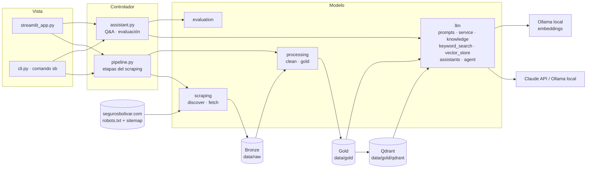
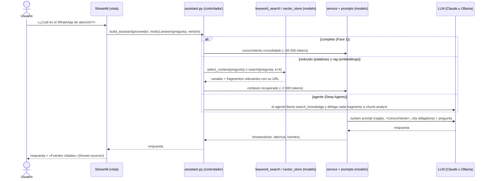
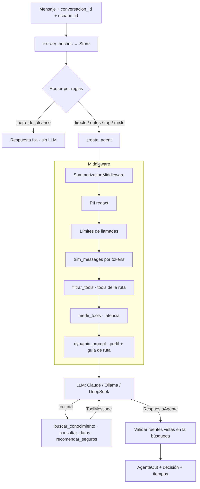
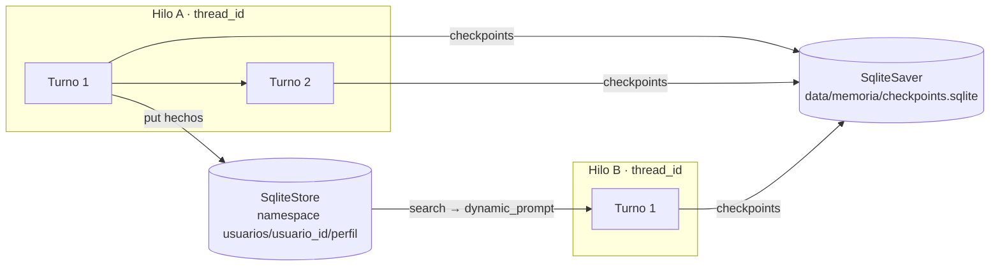
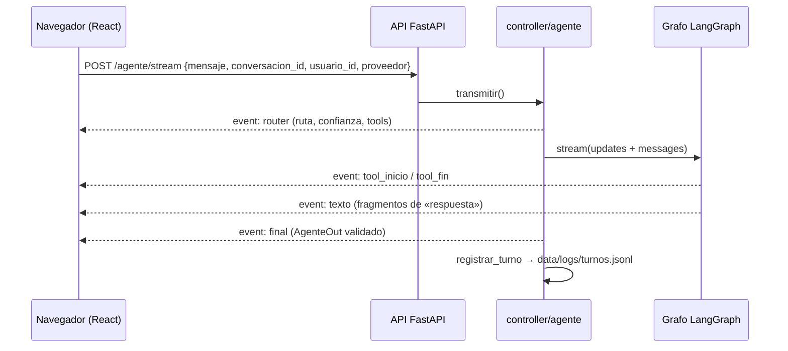

# Arquitectura · Asistente Seguros Bolívar

## Diagrama por capas (MVC)

La vista **solo** conoce al controlador; el controlador orquesta el modelo. Ninguna capa inferior
importa una superior.

## Responsabilidad única por módulo

| Capa | Módulo | Responsabilidad | Entrada ➔ Salida |
|---|---|---|---|
| Modelo | `model/scraping/discover.py` | robots.txt, sitemap y filtro de alcance | sitemap ➔ plan de captura con motivos de descarte |
| Modelo | `model/scraping/fetch.py` | Descarga con cortesía, timeout y reanudación | URLs ➔ Bronze (HTML + `capture.jsonl`) |
| Modelo | `model/processing/clean.py` | Contenido principal y boilerplate | HTML ➔ texto Silver |
| Modelo | `model/processing/gold.py` | Metadatos, Markdown, corpus, chunks, conocimiento | Silver ➔ Gold |
| Modelo | `model/llm/prompts.py` | Prompts versionados v1–v4 (única fuente de prompts) | — |
| Modelo | `model/llm/service.py` | LangChain con Claude u Ollama; modo «completo», Resumen y FAQ | conocimiento + pregunta ➔ `Answer` (texto, fuentes) |
| Modelo | `model/llm/knowledge.py` | Leer la base de Gold: conocimiento, chunks y bloque de canales | archivos Gold ➔ texto / chunks |
| Modelo | `model/llm/keyword_search.py` | Búsqueda por palabras (modo «reducido») | pregunta + chunks ➔ contexto con URLs |
| Modelo | `model/llm/vector_store.py` | Embeddings locales e índice Qdrant (modo «rag») | chunks ➔ índice; pregunta ➔ fragmentos |
| Modelo | `model/llm/agent.py` | Deep Agent: herramienta de búsqueda y subagente (modo «agente») | pregunta ➔ respuesta del agente |
| Modelo | `model/llm/assistants.py` | Q&A sobre contexto recuperado (`RetrievalAssistant`, `AgentAssistant`) | pregunta ➔ `Answer` |
| Modelo | `model/evaluation.py` | Banco de preguntas y métricas | respuestas ➔ CSV y resumen |
| Controlador | `controller/pipeline.py` | Etapas del scraping y su reporte | — ➔ métricas por etapa y tabla del corpus |
| Controlador | `controller/assistant.py` | Arma cada modo (completo, reducido, rag, agente) con la configuración y orquesta la evaluación | proveedor + modo ➔ asistente; banco ➔ métricas |
| Vista | `view/streamlit_app.py`, `view/app_pages/`, `view/ui.py`, `app.py` | Interfaz web en dos áreas: atención al cliente y panel del equipo (ADR-021) | clics ➔ llamadas al controlador |
| Vista | `view/cli.py` | Comando `sb` | argumentos ➔ llamadas al controlador |

## Flujo de inferencia

## Medallion

| Capa | Carpeta | Contenido | Se regenera con |
|---|---|---|---|
| Bronze | `data/raw/` | HTML crudo, `capture.jsonl`, `plan_captura.json`, `robots.txt` | `make data` |
| Silver | `data/silver/` | Texto limpio por página | `make process` |
| Gold | `data/gold/` | `pages/*.md` con frontmatter, `corpus.jsonl`, `chunks.jsonl`, conocimiento consolidado, `resumen.json` | `make process` |
| Índice | `data/gold/qdrant/` | Embeddings de los chunks (Fase 2) | `make index` |

## Patrones de diseño

- **Inyección de dependencias:** sesión HTTP, reloj, `sleep` y LLM entran por constructor; las
  pruebas usan dobles (`FakeSession`, `FakeListChatModel`) y corren sin red ni API.
- **Strategy:** el proveedor de LLM se elige por configuración (`build_llm`) y el modo de contexto por
  `build_assistant`: cada modo es una función de búsqueda distinta sobre el mismo `RetrievalAssistant`.
- **Fachada:** `controller/assistant.py` y `controller/pipeline.py` son los únicos puntos de entrada
  para la UI y la CLI.

## Despliegue

`Dockerfile` multi-stage (CPU): *builder* con `uv` ➔ *runtime* con Python, `.venv` y código, usuario
sin privilegios, `data/` como volumen. Ver ADR-008.

---

## Módulo 2 · Agente conversacional (SPEC-007 a SPEC-036)

Diagrama interactivo de runtime: [`docs/arquitectura.html`](arquitectura.html), generado con **Archify** (tipo
*architecture*, perfil *showcase*, con evidencia del repositorio en cada componente). Fuente:
[`arquitectura.json`](arquitectura.json); se regenera con
`node .agents/skills/archify/bin/archify.mjs finalize architecture docs/arquitectura.json docs/arquitectura.html --repo-root . --quality showcase`
(la skill se instala con `make skill-add REPO=tt-a1i/archify SKILL=archify`).

### Grafo del agente (router → modelo ↔ tools → salida estructurada)

| Ruta | Tools que ve el modelo | Ejemplo |
|---|---|---|
| `directo` | ninguna | «hola», «me llamo Ana», «¿dónde trabajo?» |
| `datos` | `consultar_datos` | «¿cuántas pólizas se vendieron en el T3 de 2025?» |
| `rag` | `buscar_conocimiento`, `recomendar_seguros` | «¿qué cubre el SOAT?» |
| `mixto` | `buscar_conocimiento`, `consultar_datos` | «¿qué cubre hogar y cuántas pólizas de hogar se vendieron?» |
| `fuera_de_alcance` | — (sin LLM) | «¿quién ganó el mundial?» |

### Memoria: checkpointer (corto plazo) vs. Store (largo plazo)

- **Corto plazo:** cada hilo se guarda por `thread_id` y sobrevive al reinicio del proceso. Además,
  `GET /agente/conversaciones/{id}/checkpoints` permite el *time travel*.
- **Largo plazo:** el perfil del usuario (nombre, empresa, vehículo…) se recupera en cualquier hilo
  nuevo. Se borra con `DELETE /agente/usuarios/{id}/perfil`.
- **Ventana de contexto:** `SummarizationMiddleware` resume lo antiguo y `trim_messages` recorta
  por tokens.

### Secuencia del streaming (frontend ↔ API)

### Trazas

- **Local:** `data/logs/turnos.jsonl` guarda una línea por turno, sin el texto del usuario: ruta, tools
  con sus milisegundos, fuentes y errores. `sb trazas` muestra las últimas.
- **API:** `X-Request-ID` y `X-Process-Time-ms` en cada respuesta, con un log JSON por petición.
- **LangSmith:** con `LANGSMITH_TRACING=true`, cada turno se etiqueta `ruta:<r>`.
