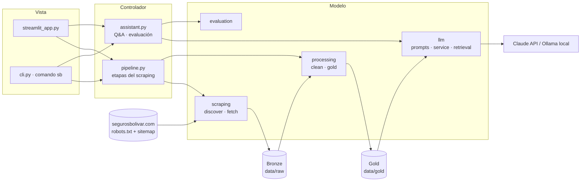
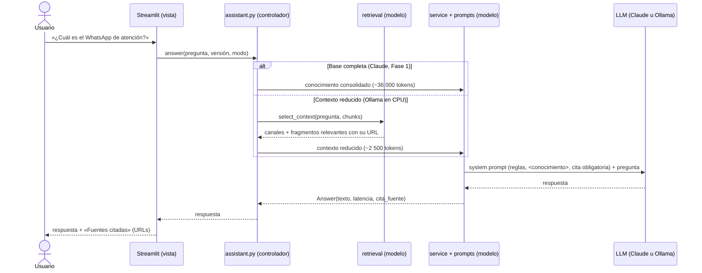

# Arquitectura · Asistente Seguros Bolívar

## Diagrama por capas (MVC)

La vista **solo** conoce al controlador; el controlador orquesta el modelo. Ninguna capa inferior
importa una superior.

## Responsabilidad única por módulo

| Capa | Módulo | Responsabilidad | Entrada ➔ Salida |
|---|---|---|---|
| Modelo | `model/scraping/discover.py` | robots.txt, sitemap y filtro de alcance | sitemap ➔ plan de captura con motivos de descarte |
| Modelo | `model/scraping/fetch.py` | Descarga con cortesía, timeout y reanudación | URLs ➔ Bronze (HTML + `capture.jsonl`) |
| Modelo | `model/processing/clean.py` | Contenido principal y boilerplate | HTML ➔ texto Silver |
| Modelo | `model/processing/gold.py` | Metadatos, Markdown, corpus, chunks, conocimiento | Silver ➔ Gold |
| Modelo | `model/llm/prompts.py` | Prompts versionados v1–v4 (única fuente de prompts) | — |
| Modelo | `model/llm/service.py` | LangChain con Claude u Ollama | conocimiento + pregunta ➔ `Answer` |
| Modelo | `model/llm/retrieval.py` | Contexto reducido por palabras | pregunta + chunks ➔ contexto con URLs |
| Modelo | `model/evaluation.py` | Banco de preguntas y métricas | respuestas ➔ CSV y resumen |
| Controlador | `controller/pipeline.py` | Etapas del scraping y su reporte | — ➔ métricas por etapa y tabla del corpus |
| Controlador | `controller/assistant.py` | Q&A completo / reducido y evaluación | petición ➔ `Answer` / métricas |
| Vista | `view/streamlit_app.py`, `app.py` | Interfaz web | clics ➔ llamadas al controlador |
| Vista | `view/cli.py` | Comando `sb` | argumentos ➔ llamadas al controlador |

## Flujo de inferencia

## Medallion

| Capa | Carpeta | Contenido | Se regenera con |
|---|---|---|---|
| Bronze | `data/raw/` | HTML crudo, `capture.jsonl`, `plan_captura.json`, `robots.txt` | `make data` |
| Silver | `data/silver/` | Texto limpio por página | `make process` |
| Gold | `data/gold/` | `pages/*.md` con frontmatter, `corpus.jsonl`, `chunks.jsonl`, conocimiento consolidado, `resumen.json` | `make process` |

## Patrones de diseño

- **Inyección de dependencias:** sesión HTTP, reloj, `sleep` y LLM entran por constructor; las
  pruebas usan dobles (`FakeSession`, `FakeListChatModel`) y corren sin red ni API.
- **Strategy:** el proveedor de LLM se elige por configuración (`build_llm`) sin cambiar la lógica.
- **Fachada:** `controller/assistant.py` y `controller/pipeline.py` son los únicos puntos de entrada
  para la UI y la CLI.

## Despliegue

`Dockerfile` multi-stage (CPU): *builder* con `uv` ➔ *runtime* con Python, `.venv` y código, usuario
sin privilegios, `data/` como volumen. Ver ADR-008.
