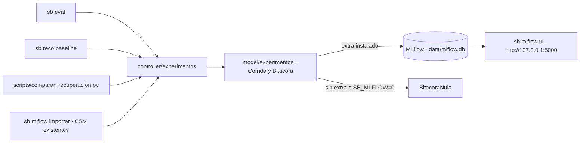

# Plan · Bitácora de experimentos con MLflow

## Cómo se verifica cada requisito
| Requisito | Pruebas (`tests/test_experimentos.py`) |
|---|---|
| R29 Trazabilidad | `test_corrida_eval_separa_parametros_y_metricas`, `test_registrar_baselines_una_corrida_por_modelo`, `test_registrar_recuperacion_guarda_hit_por_k`, `test_cli_eval_registra_la_corrida`, `test_nombre_metrica_valido_para_mlflow`, `test_mlflow_real_registra_y_encuentra_la_corrida` |
| R30 Importar | `test_importar_evaluaciones_carga_cada_csv_y_omite_las_muestras`, `test_importar_dos_veces_no_duplica` |
| R31 Opcional | `test_sin_mlflow_o_apagado_se_usa_la_bitacora_nula`, `test_cli_mlflow_sin_extra_explica_como_instalarlo`; `tests/conftest.py` fija `SB_MLFLOW=0` |

## Riesgos
- Tamaño de la dependencia: por eso es un extra opcional.
- El LightGBM (T-23) debe guardar el modelo en formato de texto, no pickle (criterio del backlog de Gestión).
