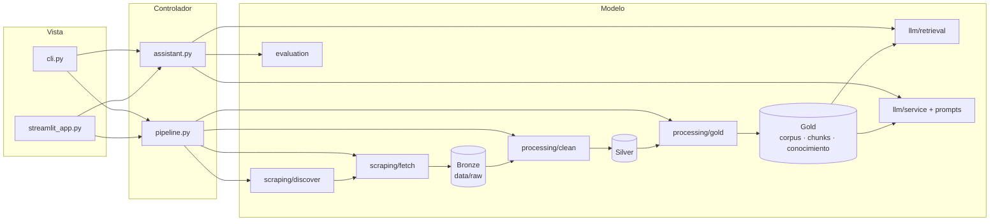

# Plan · Fase 1 — cómo se construye

## Arquitectura (MVC + Medallion)

## Decisiones técnicas

| Tema | Decisión | Referencia |
|---|---|---|
| Contexto del LLM | Base completa en el system prompt (Claude); contexto reducido para Ollama | ADR-001, ADR-006 |
| Alcance | Personas + canales; blog y PDFs a Fase 2 | ADR-002 |
| Descarga | `requests` + trafilatura (sitio SSR), 1,5 s entre peticiones | ADR-003 |
| Modelo | Claude Haiku por API; Ollama `llama3.2:3b` local | ADR-005 |
| Estructura | MVC `model/` · `controller/` · `view/` | ADR-007 |
| Empaquetado | Docker multi-stage CPU; estándar jan-project-standard | ADR-008 |

## Fases de implementación

1. **Datos:** descubrir → Bronze → Silver → Gold, con pruebas sobre fixtures HTML.
2. **LLM:** prompts versionados v1–v4, servicio LangChain con proveedor intercambiable.
3. **Interfaz:** pestañas Pipeline, Q&A, Resumen, FAQ y Evaluación.
4. **Evaluación:** banco de 24 preguntas y comparación de prompts.
5. **Operación:** MVC, Docker, Makefile, CI, gobernanza del repositorio.

## Riesgos y mitigación

| Riesgo | Mitigación |
|---|---|
| Cambios en el sitio rompen la extracción | Bronze inmutable + `make process` para reprocesar sin red |
| Latencia de modelos locales | Contexto reducido (R4) |
| Alucinaciones | Regla de no-información, cita obligatoria y preguntas trampa en el banco |
| Exposición de datos | Solo información pública; `data/` y `.env` bloqueados por pre-commit |
