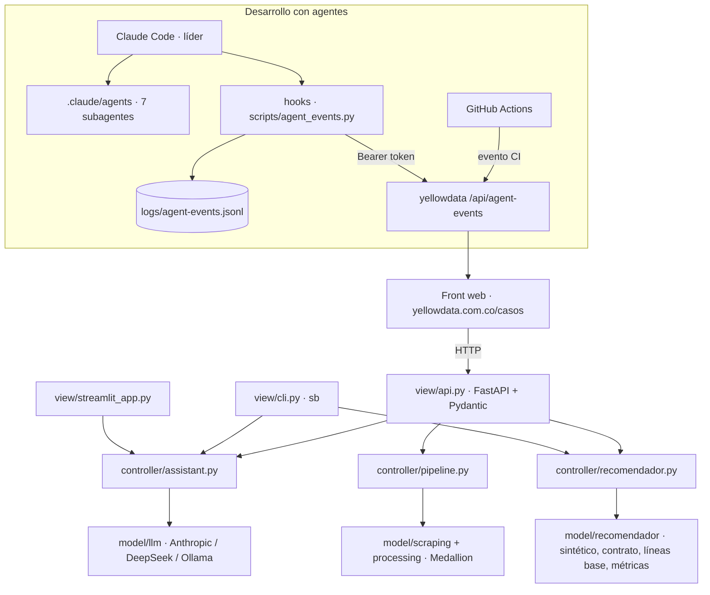

# Plan · Fase 2 — Producto único

## Arquitectura

## Decisiones
- ADR-009 repositorio único (público) · ADR-010 FastAPI + Pydantic · ADR-011 subagentes y
  telemetría · ADR-012 DeepSeek como proveedor alterno.

## Cómo se verifica cada requisito
| Requisito | Pruebas |
|---|---|
| R7 API | `tests/test_api.py` (TestClient, dobles del LLM; 422/404/503) |
| R8 Recomendador | `tests/test_reco_*.py` (contrato, sintético, métricas, CLI, top-k) |
| R9 Proveedor | `tests/test_llm.py` + `context_budget` por proveedor |
| R10 Agentes | `tests/test_agent_events.py` (saneo, rutas privadas, token) |

## Riesgos
- Costo de tokens: modelo `claude-haiku-5-5` por defecto, caché de prompt, contexto reducido y
  saldo inicial de 10 USD; DeepSeek si el costo sube.
- Exposición pública del panel: solo eventos saneados y escritura con token.
- cPanel con un solo proceso Node: eventos en memoria + archivo `.data/agent-events.jsonl`.
