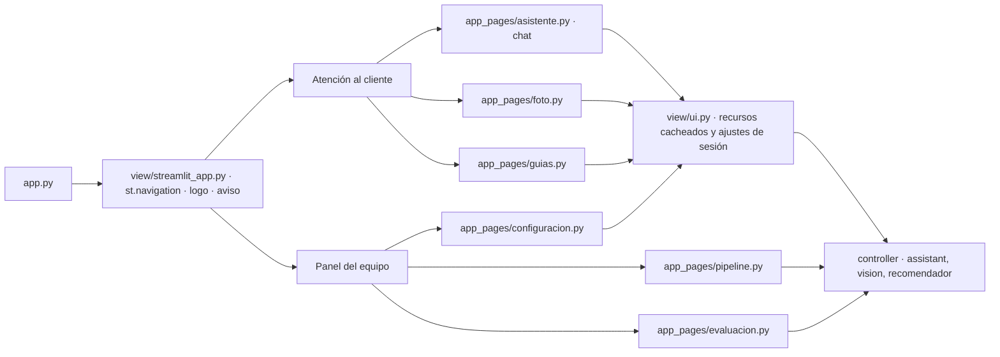

# Plan · Interfaz en dos áreas

## Estructura

- Cada página es un script directo en `view/app_pages/`; solo hablan con `view/ui.py` y el
  controlador (MVC).
- Tema: `.streamlit/config.toml` (azul marino y grises, Inter, barra lateral oscura,
  `client.toolbarMode = "viewer"`, `server.maxUploadSize = 8`). Logo SVG neutro en `view/assets/`.

## Cómo se verifica cada requisito
| Requisito | Pruebas (`tests/test_streamlit_ui.py`, con `AppTest` y un asistente falso) |
|---|---|
| R25 Dos áreas | `test_cada_pagina_carga_sin_errores` (6 páginas), `test_navegacion_separa_cliente_y_equipo`, `test_area_del_cliente_no_muestra_ajustes_tecnicos` |
| R26 Chat | `test_chat_responde_con_fuente_y_guarda_historial`, `test_pregunta_sugerida_inicia_la_conversacion`, `test_nueva_conversacion_borra_el_historial`, `test_nueva_conversacion_tras_sugerencia_no_repite_la_pregunta`, `test_error_del_modelo_se_muestra_sin_romper_la_pagina` |
| R27 Estilo | revisión visual con capturas (`docs/capturas/`) y `test_etiqueta_fuente_es_corta_y_legible` |
| R28 Configuración | `test_configuracion_cambia_la_version_que_usa_el_chat` |

## Riesgos
- Las claves de widgets se borran al cambiar de página: los ajustes se copian a claves propias de
  `st.session_state`.
- `[client]` y `[server]` de `config.toml` solo se leen al arrancar: tras cambiarlos hay que reiniciar.
