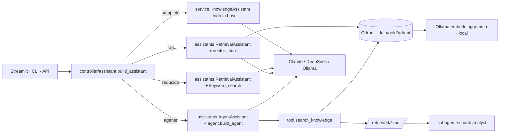

# Plan · Modos «rag» y «agente»

## Arquitectura

## Módulos
| Módulo | Responsabilidad |
|---|---|
| `model/llm/knowledge.py` | leer Gold: conocimiento, fragmentos y bloque de canales |
| `model/llm/keyword_search.py` | búsqueda por palabras (modo «reducido») |
| `model/llm/vector_store.py` | embeddings, huella del contenido, índice Qdrant y búsqueda |
| `model/llm/agent.py` | herramienta de búsqueda y Deep Agent |
| `model/llm/assistants.py` | `RetrievalAssistant` y `AgentAssistant` |
| `controller/assistant.py` | arma cada modo con la configuración y orquesta la evaluación |

## Cómo se verifica cada requisito
| Requisito | Pruebas |
|---|---|
| R16 Modos | `tests/test_controller.py::test_build_assistant_every_mode_answers_with_source`, `tests/test_rag_qdrant.py::test_cli_ask_passes_mode` |
| R17 Índice | `tests/test_rag_qdrant.py` (reutiliza sin recalcular, reconstruye si cambia, error sin Ollama, copia si está bloqueado) |
| R18 Agente | `tests/test_rag_qdrant.py` (herramienta guarda fragmentos con fuente, sin resultados, backend que falla, grafo compilado) |
| R19 Claude | `tests/test_llm.py::test_build_llm_anthropic_never_sends_temperature` |
| Calidad de respuesta | `uv run sb eval --modo rag` y `--modo agente` frente a `completo` ([`docs/evaluacion-resultados.md`](../../../docs/evaluacion-resultados.md)) |

## Riesgos
- El agente con modelos pequeños (llama3.2:3b) no sigue bien el flujo de herramientas: se recomienda Claude.
- Qdrant local admite un solo proceso por carpeta: se comparte el cliente en el proceso y se usa una
  copia temporal si otro proceso la tiene tomada.
