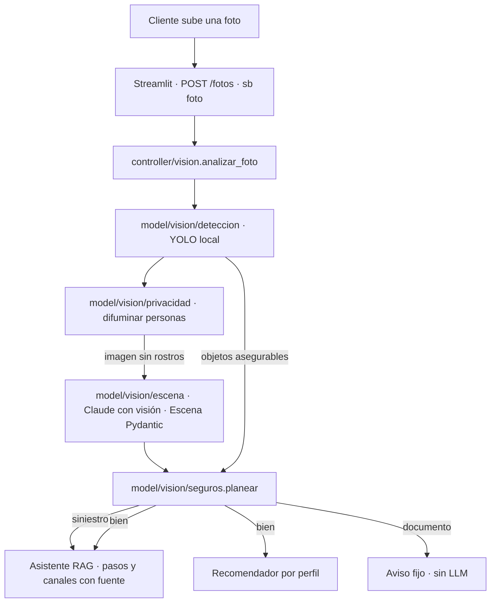

# Plan · Foto → «¿qué hago?»

## Arquitectura

## Qué se tomó del ejercicio `ejercicio_gestion_fastapi`
| Ejercicio | Proyecto |
|---|---|
| `app/main.py`: `POST /api/v1/detect` con `UploadFile` | `view/api.py`: `POST /fotos` |
| `lifespan` carga YOLO | igual, y además lo calienta (primera foto: de ~40 s a ~0,2 s) |
| `run_in_threadpool` + `Lock` | igual |
| `app/schemas.py` | `view/schemas.py`: `FotoOut`, `EscenaOut`, `PlanOut` |
| `client.py` (httpx) | `view/api_client.py` y `sb foto --api URL` |
| `frontend/annotations.py` | `view/anotaciones.py` |

## Cómo se verifica cada requisito
| Requisito | Pruebas |
|---|---|
| R20 Privacidad | `tests/test_vision_flujo.py` (difuminado, personas apartadas, foto difuminada a Claude, documento sin LLM) y `tests/test_vision.py::test_filtrar_nunca_reporta_personas` |
| R21 Escena | `tests/test_vision_flujo.py` (imagen y reglas al modelo, `json_schema`, proveedor sin visión) |
| R22 Plan | `tests/test_vision_flujo.py` (siniestro, la escena manda sobre YOLO, confianza baja usa YOLO, perfil) |
| R23 API y cliente | `tests/test_vision.py` y `tests/test_vision_flujo.py` (400, 422, 503, flujo completo, cliente httpx) |
| R24 Extra opcional | la CI corre las 44 pruebas de visión sin `ultralytics` |
| Prueba real | fotos de Wikimedia Commons: choque, gotera, moto de primeros auxilios y niña con su perro (ADR-020) |

## Riesgos
- Placas: YOLO (COCO) no las detecta; el prompt prohíbe transcribirlas y la interfaz pide no enviarlas.
- Costo: dos llamadas a Claude por foto (escena y respuesta), fracciones de centavo con Haiku.
